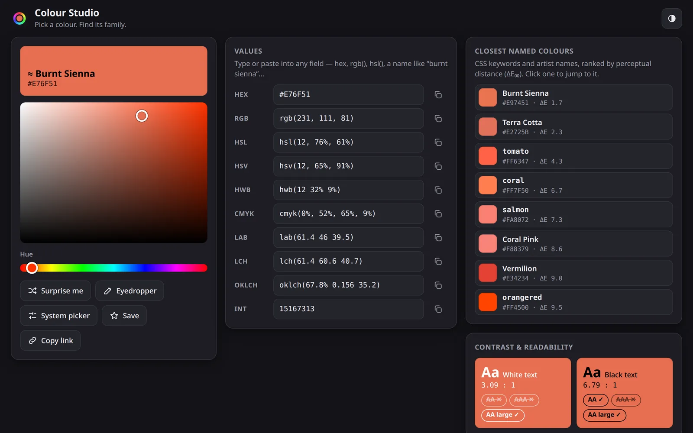
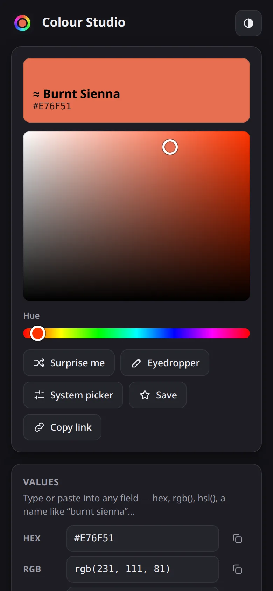

# Colour Studio

[](https://github.com/ali-raheem/colour-studio/actions/workflows/ci.yml) [](https://github.com/ali-raheem/colour-studio/actions/workflows/pages.yml)

**▶ Try it live: [shoryuken.me/colours](https://shoryuken.me/colours/)** · mirror on [GitHub Pages](https://ali-raheem.github.io/colour-studio/) · installable, works offline

<p align="center">
  <a href="https://shoryuken.me/colours/"></a>
  <a href="https://shoryuken.me/colours/"></a>
</p>

An offline-installable colour picker and palette generator. Pick or type a colour, see it in every
common format, find its nearest named colours, and generate palettes around it — harmonies, scales,
gradients and UI/accessibility sets.

Plain HTML/CSS/JS. No build step, no dependencies, no network calls.

## Run it

Any static file server works. The service worker (offline + install) needs `http://localhost` or HTTPS:

```bash
python3 -m http.server 8080      # then open http://localhost:8080
```

Opening `index.html` straight from disk also works, just without install/offline support.

## Install & offline

- **Chrome / Edge / Android:** use the **Install** button in the header (or the address-bar icon).
- **iPhone / iPad:** Share → **Add to Home Screen**.
- After the first load a **Ready offline** badge appears. Everything is precached, so it works with no connection.
- The app also asks the browser to exempt its storage from "clear least-used site data" eviction
  (`navigator.storage.persist()`), so the offline cache and your saved colours are less likely to be
  wiped under disk pressure. This is silent and best-effort — Chromium auto-grants it for an installed
  or frequently-visited PWA with no prompt; other browsers may ignore it or ask. The app works offline
  either way, just with a (usually theoretical) risk of the cache being cleared if it's declined.

To publish, copy the folder to any static host with HTTPS (GitHub Pages, Netlify, S3…). All paths are
relative, so it also works from a sub-path like `https://you.github.io/colours/`.

> **Commit your changes, then run `python3 scripts/build_version.py`, then deploy.** Files are
> served cache-first, so returning users only pick up changes when the service worker's cache name
> changes; they then see a "new version is ready" prompt. The script stamps a version — this repo's
> short commit hash (so commit first, or the stamp reflects the previous commit) or, outside a git
> checkout, a hash of the app's files — into both `js/version.js` (shown in the footer) and `sw.js`'s
> `VERSION`, so the two can't drift apart and a deploy can't go out with a stale cache name.
> `js/version.js` is gitignored — it's a deploy-time artifact, regenerated fresh each time, never
> committed — and `tests/version.test.js` fails the suite if the one on disk is stale for the current
> commit/files. `tests/sw.test.js` checks that every file the page loads is in the precache list.

## What it does

**Pick:** saturation/brightness square, hue slider, system colour picker, eyedropper (Chromium), random
colour (`R`), keyboard control (arrow keys, `Shift` for bigger steps), saved colours, one-step undo when you jump to a swatch.

**Read:** HEX, RGB, HSL, HSV, HWB, CMYK, Lab (D50), LCH, OKLCH and integer. Every field is editable, and
accepts hex, `rgb()`, `hsl()`, `hsv()`, `cmyk()`, `lab()`, `oklch()`, or a colour name.

**Compare:** the 8 nearest named colours (139 CSS colours plus ~85 artist/design names such as
*Burnt Sienna*, *Cerulean*, *Viridian*), ranked by CIEDE2000. Plus WCAG contrast against white and black.

**Generate** (with 3–12 colours where a palette can vary in size):

| Harmonies | Scales & variations | Gradients | Design |
|---|---|---|---|
| Complementary | Monochromatic | To complement | Interface 60-30-10 |
| Split complementary | Tints | Analogous glide | UI scale 50–950 |
| Analogous (adjustable spread) | Shades | | Tinted neutrals |
| Accented analogous | Tones | | Accessible partners (WCAG) |
| Triadic · Tetradic · Square | Moods (pastel → deep) | | |

Every swatch can be clicked to make it your new base colour, or copied. Each palette copies as a HEX list, CSS
variables, or JSON.

### Three colour wheels

Hue-based palettes depend on what "opposite" means, so you can choose:

- **Artist (RYB)** — the painter's wheel. Red ↔ green, orange ↔ blue, yellow ↔ violet. *(default)*
- **Digital (RGB)** — the screen's wheel. Red ↔ cyan.
- **Perceptual (OKLCH)** — hues rotate at constant perceived lightness, so every colour in a harmony carries equal visual weight.

### Settings live next to what they change

There's no single global settings panel — each control sits in the group (or, for Analogous spread,
the one card) it actually affects, right above the card that proves it works:

- **Colour wheel** — in the *Colour harmonies* group header. Complementary, the card right below it,
  changes immediately when you switch wheels.
- **Colours per palette** — in the *Scales & variations* group header. Monochromatic, right below,
  changes count immediately. (It also sizes Analogous above and Tinted neutrals / both gradients below —
  said explicitly in a note under the control, since that reach isn't obvious from where it sits.)
- **Analogous spread** — embedded directly in the Analogous card itself, since it's the only palette
  it changes.

The group/card headers (and the controls inside them) are built once and never rebuilt after that — only
a card's own swatches and wheel diagram are replaced, and only when their shape actually changes. That's
what stops the Analogous spread slider from being pulled out from under your pointer mid-drag.

### Shareable links

State lives in the URL hash: `#c=E76F51&w=ryb&n=5&a=30` (colour, wheel `ryb|hsl|oklch`, palette size, analogous spread).
"Copy link" grabs it. Saved colours and preferences are kept in `localStorage`.

## Project layout

```
index.html                 page shell
style.css                  all styling (light + dark, responsive)
js/color.js                conversions, parsing, formatting, contrast, ΔE₀₀, OKLab mixing
js/names.js                named colours + nearest search
js/palettes.js             wheels and palette generators
js/app.js                  UI
js/version.js              (generated) shown in the footer — gitignored, don't edit by hand
sw.js                      service worker (precache list + VERSION live here)
manifest.webmanifest       install metadata
icons/                     generated by scripts/make_icons.py (python3, stdlib only)
scripts/build_version.py   stamps js/version.js + sw.js's VERSION — run before every deploy
tests/                     node --test tests/*.test.js  (maths, palettes, offline-asset, version checks)
```

## Tests

```bash
node --test tests/*.test.js     # Node 18+, no install needed
```

Covers colour-space reference values, CIEDE2000 against the published test pairs, parse/format round trips,
palette invariants (sizes, gamut, WCAG targets), that every file the page loads is in the service worker's
precache list, and that `js/version.js` is current for the committed files.

## Licence

[MIT](LICENSE) © 2026 Ali Raheem.
